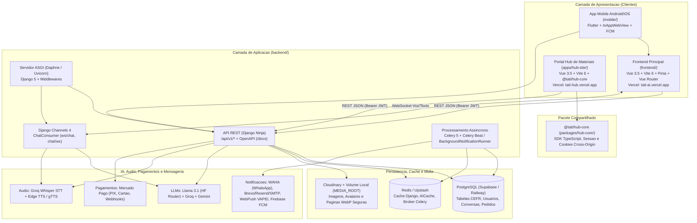

# Arquitetura do Sistema

O **Teacher Tatiana AI (Tati AI)** e uma plataforma educacional para ensino de lingua inglesa alinhada ao quadro **CEFR (A1 a C2)**, estruturada como um **monorepo NPM Workspaces** que combina um backend **Django 5 + Django Ninja + Channels + Celery**, duas aplicacoes web em **Vue 3 + Vite + TypeScript**, uma biblioteca compartilhada (`@tati/hub-core`) e um aplicativo movel **Flutter**.

---

## 1. Visao Geral da Arquitetura

---

## 2. Stack Tecnologica Confirmada

| Camada | Tecnologias Confirmadas no Codigo | Evidencia Principal |
| :--- | :--- | :--- |
| **Monorepo Web** | NPM Workspaces (`frontend`, `apps/*`, `packages/*`), Node.js 20+ | [`../package.json`](../package.json) |
| **Backend API e Tempo Real** | Python 3.11/3.12, Django 5, Django Ninja 1.3+, Django Channels 4, Daphne, Uvicorn, Gunicorn, Pydantic v2 | [`../backend/requirements.txt`](../backend/requirements.txt), [`../backend/app/api.py`](../backend/app/api.py), [`../backend/app/asgi.py`](../backend/app/asgi.py) |
| **Jobs e Agendamento** | Celery 5, `django-celery-beat`, `django-celery-results`, `BackgroundNotificationRunner` | [`../backend/app/celery.py`](../backend/app/celery.py), [`../backend/apps/notifications/scheduler.py`](../backend/apps/notifications/scheduler.py) |
| **Frontend Principal (`frontend/`)** | Vue 3.5 (Composition API), Vite 6, TypeScript, Vue Router 4, Pinia 2.3, TanStack Vue Query 5, VueUse, Tailwind CSS 3.4, Lucide Vue Next, Marked | [`../frontend/package.json`](../frontend/package.json) |
| **Portal Hub (`apps/hub-site/`)** | Vue 3.5, Vite 6, TypeScript, Vue Router 4, Pinia 2.3, TanStack Vue Query 5, Tailwind CSS 3.4, `@tati/hub-core` | [`../apps/hub-site/package.json`](../apps/hub-site/package.json) |
| **SDK Compartilhado** | `@tati/hub-core` (TypeScript puro: cliente HTTP, autenticacao, sessao, catalogo, niveis CEFR) | [`../packages/hub-core/package.json`](../packages/hub-core/package.json) |
| **Aplicativo Mobile (`mobile/`)** | Flutter (Dart SDK `>=3.2.0`), `flutter_inappwebview`, `firebase_messaging`, `flutter_local_notifications`, `google_sign_in`, `flutter_secure_storage` | [`../mobile/pubspec.yaml`](../mobile/pubspec.yaml), [`../mobile/lib/main.dart`](../mobile/lib/main.dart) |
| **Banco de Dados** | PostgreSQL (Supabase / Railway via `dj-database-url` e `psycopg2-binary`), fallback local SQLite (`db.sqlite3`) | [`../backend/app/settings/base.py`](../backend/app/settings/base.py) |
| **Cache** | Redis (`django-redis`), Upstash Redis REST, `AICache` (Redis + LRU em RAM), IndexedDB no navegador | [`../backend/shared/ai_cache.py`](../backend/shared/ai_cache.py), [`../frontend/src/api/indexedDB.ts`](../frontend/src/api/indexedDB.ts) |
| **IA, RAG e Audio** | Meta Llama 3.1 (HF Router), Groq (`gpt-oss-120b`/`20b` + Whisper Large V3), Google Gemini, Embeddings `BAAI/bge-large-en-v1.5`, Edge TTS + gTTS | [`../backend/apps/chat/services.py`](../backend/apps/chat/services.py), [`../backend/apps/chat/rag/`](../backend/apps/chat/rag/), [`../backend/apps/chat/audio_service.py`](../backend/apps/chat/audio_service.py) |
| **Pagamentos** | Mercado Pago (`mercadopago` SDK: PIX QR Code, Checkout Pro, Webhooks) | [`../backend/apps/payments/services.py`](../backend/apps/payments/services.py) |
| **Comunicacao e Midia** | WAHA (WhatsApp HTTP API), Brevo / Resend / SMTP, WebPush (`pywebpush`), Firebase Admin, Cloudinary, LibreOffice + Poppler + PyMuPDF + ReportLab | [`../backend/apps/notifications/`](../backend/apps/notifications/), [`../backend/apps/activities/secure_document_service.py`](../backend/apps/activities/secure_document_service.py) |
| **Testes e Qualidade** | Django `manage.py test` (`UnmanagedModelTestRunner`), Flake8, `vue-tsc`, Playwright E2E | [`../.github/workflows/ci.yml`](../.github/workflows/ci.yml), [`../playwright.config.ts`](../playwright.config.ts) |

---

## 3. Divisao de Aplicacoes e Fronteiras do Monorepo

### 3.1. Frontend Principal (`frontend/` — porta `3000`)
Atende dois perfis autenticados e rotas publicas institucionais:
- **Visitantes**: Landing Page (`/`), Teste de Nivelamento CEFR gratuito (`/cefr-test`) e Politica de Privacidade (`/privacidade`).
- **Alunos (`role="student"`)**: Chat com a Teacher Tati (`/chat`), Tutoria Imersiva por Voz (`/voice` e `/voice-only`), Hub de Atividades (`/activities`), Pratica Fonetica (`/pronunciation`), Flashcards SRS (`/flashcards/:deckId`), Vocabulario (`/vocab`), Listenings (`/listenings`), Exames Trimestrais (`/exams`), Progresso (`/progress`), Metas Semanais (`/goals`), Trofeus (`/achievements`), Ranking (`/competitions`), Loja/Planos (`/shop`, `/payment`) e Leitor de Materiais (`/activities/hub/*`).
- **Professora e Administradores (`role="teacher"` ou `"admin"`)**: Painel Administrativo (`/dashboard`) com gestao de alunos, curadoria e geracao automatica CEFR, upload de materiais do Hub, revisao de feedbacks, relatorios PDF/CSV e disparos via WhatsApp.

### 3.2. Portal Dedicado do Hub (`apps/hub-site/` — porta `3001`)
Aplicacao SPA independente (`@tati/hub-site`) implantada em dominio proprio (`https://tati-hub.vercel.app`) para comercializacao e leitura segura dos materiais didaticos digitais ("Taty's Materials"):
- Consome diretamente o pacote workspace [`../packages/hub-core/`](../packages/hub-core/) (`@tati/hub-core`).
- Permite navegacao publica pelo catalogo (`/materiais`), compra avulsa via PIX ou Cartao no Mercado Pago, gestao de pedidos (`/pedidos`), biblioteca de materiais adquiridos (`/meus-materiais`) e leitura protegida (`/materiais/:id/ler`) sem exigir assinatura completa da plataforma de tutoria.
- Compartilha sessao com o ecossistema principal quando hospedado sob mesmo dominio raiz por meio de cookies cross-subdomain (`auth-cookie.ts`) ou redirecionamento OAuth com parametro `?access=hub`.

### 3.3. Aplicativo Mobile (`mobile/`)
Wrapper nativo em **Flutter** que renderiza a aplicacao web responsiva dentro de `InAppWebView`, adicionando recursos nativos que navegadores moveis restringem:
- Login nativo com Google (`google_sign_in`) sincronizado com `/api/v1/auth/google/mobile` e injetado no `localStorage` da WebView.
- Notificacoes Push nativas via **Firebase Cloud Messaging (FCM)** registradas em `/api/v1/notifications/fcm-subscribe`.
- Permissoes nativas de microfone para conversacao por voz e pratica de pronuncia.
- Verificacao automatica de atualizacoes do APK via `/downloads/version.json`.

---

## 4. Fluxos Criticos de Comunicacao

### 4.1. Fluxo de Voz e Conversacao em Tempo Real
1. O cliente abre uma conexao WebSocket em `wss://<backend>/ws/chat?token=<jwt>` (ou `/chat/ws`) gerenciada pela classe `TatiWebSocket` (`frontend/src/ws/socket.ts`).
2. Ao gravar fala no navegador (`useAudioRecorder.ts`), o audio em Base64 e enviado ao `ChatConsumer` no Django Channels.
3. O backend transcreve a fala com **Groq Whisper**, consulta contexto pedagogico relevante via **RAG** (`cefr_documents`) quando aplicavel, processa a resposta e correcoes gramaticais no LLM usando prompts de `backend/ai/prompts/` e sintetiza a resposta falada com **Edge TTS** no sotaque escolhido pelo aluno.
4. O pacote JSON contendo transcricao do usuario, texto da professora, correcoes estruturadas e audio Base64 retorna pelo WebSocket (com fallback REST em `POST /api/v1/chat/conversations/{id}/voice`).

### 4.2. Protecao de Documentos Digitais (DRM Leve e Marca d'Agua)
1. Quando a professora cadastra um PDF ou DOCX no painel (`/api/v1/admin/premium`), a task `sync_material_pages` converte cada pagina em imagem **WebP** usando LibreOffice + Poppler (`pdf2image`) ou `PyMuPDF`, persistindo no volume local (`MEDIA_ROOT/hub_pages/{content_id}/`) e/ou armazenamento externo.
2. Ao abrir `/materiais/:id/ler` (no `hub-site`) ou `/activities/hub/:id/ler` (no `frontend`), o cliente solicita permissao em `GET /api/v1/activities/hub/{id}/access`, que valida a compra (`premium_purchases`) ou papel docente e emite um token temporario com escopo restrito `hub_read:{content_id}`.
3. O componente `SecureDocumentViewer.vue` requisita pagina a pagina em `GET /api/v1/activities/hub/{id}/pages/{page_index}?token=...`; o backend aplica marca d'agua dinamica (`apply_watermark`) com a identificacao do leitor antes de transmitir os bytes WebP e bloqueia atalhos de download/impressao na interface.

---

## 5. Topologia de Deploy

| Componente | Plataforma de Producao | Arquivo de Configuracao |
| :--- | :--- | :--- |
| **Frontend Principal (`frontend/`)** | Vercel (`https://tati-ai.vercel.app`) | [`../vercel.json`](../vercel.json), [`../frontend/vercel.json`](../frontend/vercel.json) |
| **Portal Hub (`apps/hub-site/`)** | Vercel (`https://tati-hub.vercel.app`) | [`../apps/hub-site/vercel.json`](../apps/hub-site/vercel.json) |
| **Backend API + Channels** | Hugging Face Spaces (Docker) e/ou Railway | [`../backend/Dockerfile`](../backend/Dockerfile), [`../.github/workflows/deploy-hf.yml`](../.github/workflows/deploy-hf.yml), [`../railway.json`](../railway.json) |
| **Orquestracao Self-Hosted / Dev** | Docker Compose (`backend`, `frontend`, `celery_worker`, `celery_beat`) + Nginx opcional | [`../docker-compose.yml`](../docker-compose.yml), [`../nginx.conf`](../nginx.conf) |
| **Mobile APK** | Build Gradle / Flutter distribuido em `public/downloads/` | [`../mobile/pubspec.yaml`](../mobile/pubspec.yaml) |

---

## 6. Estado de Implementacao (Implementado vs Em Validacao / Planejado)

Para manter transparencia tecnica, a tabela abaixo diferencia recursos plenamente operacionais de itens parcialmente implementados ou legados no repositorio:

| Recurso | Status Atual | Detalhamento Baseado no Codigo |
| :--- | :--- | :--- |
| Compra avulsa de materiais no Hub (PIX / Cartao) | **Implementado** | Ativo em producao via Mercado Pago (`/api/v1/catalog/checkout` e `/api/v1/payments/webhook`). |
| Cobranca de assinaturas recorrentes (`/shop`, `/payment`) | **Bloqueado por data/flag** | Controlado por `SUBSCRIPTION_BILLING_ENABLED=false` e `SUBSCRIPTION_BILLING_START_DATE=2027-03-01` em `backend/app/settings/base.py`. |
| Exames Trimestrais (`/exams`) | **Em validacao restrita** | Implementado de ponta a ponta (`trimestral_exams.py` + `ExamsDoingView.vue`), mas restrito por `is_user_authorized` a professores e contas autorizadas durante testes. |
| WebSocket de Pagamentos (`/payments/ws`) | **Apenas cliente (sem consumer backend)** | `apps/hub-site/src/hooks/usePaymentWebSocket.ts` tenta conectar em `/payments/ws`, mas `backend/app/asgi.py` expoe apenas `ws/chat` e `chat/ws`. O checkout funciona via polling HTTP + webhook. |
| Aplicativo Mobile Flutter (`mobile/`) | **Implementado** | App ativo com `InAppWebView`, FCM e Google Sign-In nativo. |
| Diretorio `mobile_app/` e Desktop Tauri | **Legado / Planejado** | `mobile_app/` contem apenas documentacao antiga de Capacitor/Tauri (`README.md`, `desktop/TAURI_README.md`, `styles.py`) e workflow manual `tauri-desktop-build.yml`, sem codigo Capacitor/Tauri inicializado. |
