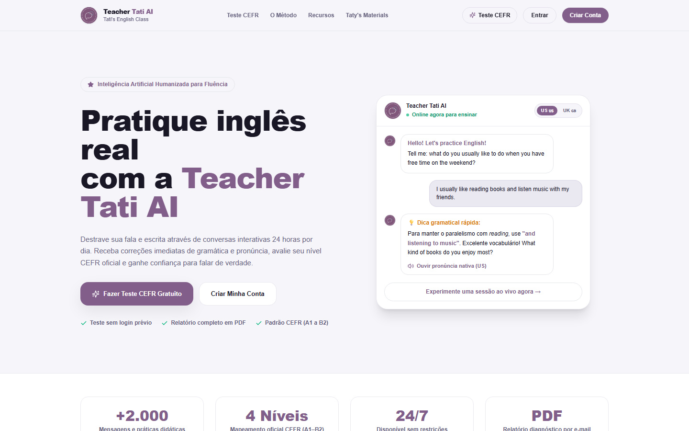
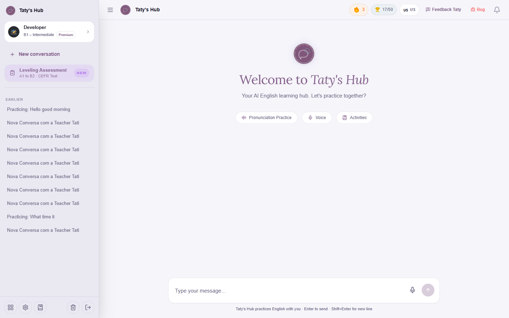
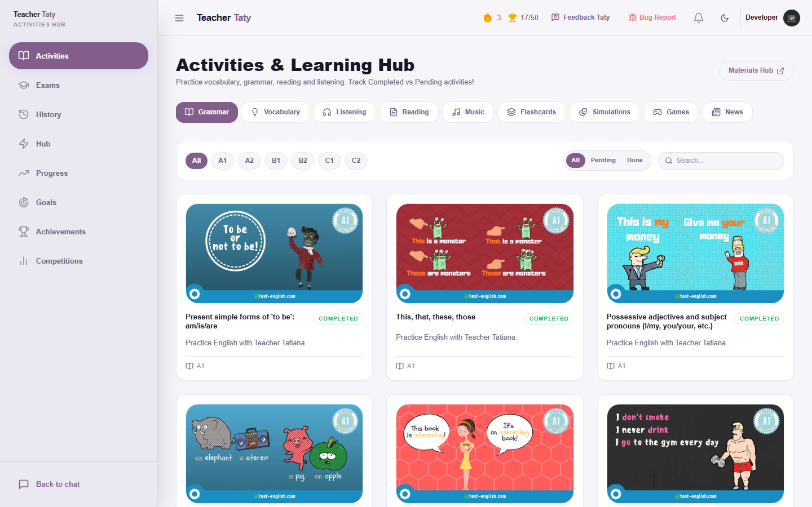
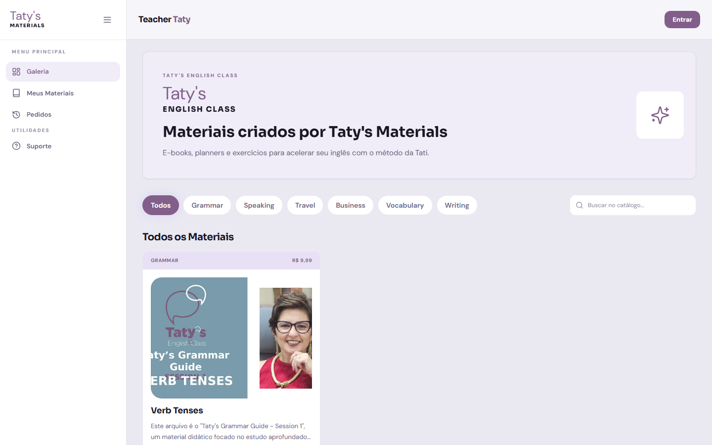

# Arquitetura e Guia do Frontend

A camada web do ecossistema **Tati AI** utiliza **Vue 3.5** (Composition API com `<script setup lang="ts">`), **Vite 6**, **TypeScript**, **Vue Router 4**, **Pinia**, **TanStack Vue Query 5** e **Tailwind CSS 3.4**, organizada em duas aplicacoes SPA complementares e um pacote compartilhado dentro do monorepo:

1. **[`../frontend/`](../frontend/)** (`porta 3000`): aplicacao principal de aprendizado para alunos (Chat IA, Voz, Atividades, Pronuncia, Flashcards, Exames, Gamificacao) e painel docente (`/dashboard`).
2. **[`../apps/hub-site/`](../apps/hub-site/)** (`@tati/hub-site`, `porta 3001`): portal independente dedicado ao catalogo comercial, checkout avulso e leitura protegida do Hub de Materiais ("Taty's Materials").
3. **[`../packages/hub-core/`](../packages/hub-core/)** (`@tati/hub-core`): SDK TypeScript interno que compartilha tipos, cliente HTTP, endpoints, regras de nivel CEFR e sessao cross-subdomain com o `apps/hub-site`.

---

## 1. Interfaces Reais das Aplicacoes

### Plataforma Principal (`frontend/`)







### Portal Taty's Materials (`apps/hub-site/`)



---

## 2. Estrutura de Diretorios

### 2.1. Aplicacao Principal (`frontend/src/`)

```text
frontend/src/
├── api/                     # Cliente HTTP com refresh JWT automatico, modulos REST e cache IndexedDB
│   ├── client.ts            # Fetch wrapper (apiGet, apiPost, apiPut, apiPatch, apiDelete, apiUpload)
│   ├── endpoints.ts         # Constantes de rotas da API (/api/v1/*)
│   ├── auth.ts              # Login, registro, OAuth e redefinicao de senha
│   ├── chat.ts              # Conversas, mensagens, nivelamento e exportacao
│   ├── activities.ts        # Flashcards, podcasts, gramatica, ranking, feedbacks e Hub
│   ├── exams.ts             # Exames trimestrais
│   ├── profile.ts           # Perfil, ofensiva e avatar
│   ├── indexedDB.ts         # Cache persistente no navegador (TTL para flashcards, podcasts e catalogo)
│   └── types.ts             # Interfaces TypeScript do dominio
├── assets/styles/
│   └── globals.css          # Tokens CSS (modo claro/escuro), tipografia (Inter, Plus Jakarta Sans, Fraunces) e utilitarios
├── components/
│   ├── activities/          # Cards de atividades, modal interativo de worksheets e SecureDocumentViewer
│   ├── catalog/             # Componentes internos da vitrine do Hub dentro do app principal
│   ├── charts/              # Graficos de distribuicao CEFR e barras de atividades
│   ├── chat/                # Sidebar do chat, bolhas de texto/voz, ClickableText, WordTooltip, LevelingModal
│   ├── dashboard/           # Secoes administrativas da professora (Alunos, CEFR, Flashcards, Simulacoes, Hub, WhatsApp)
│   ├── feedback/            # Modais de feedback pedagogico (StudentFeedbackModal) e reporte de bug (DeveloperBugModal)
│   ├── icons/               # Icones SVG customizados (ExamIcon, WhatsAppIcon)
│   ├── layout/              # AuthenticatedLayout, MainHeader, Sidebar, SidebarActivities, NotificationsDropdown
│   └── ui/                  # Design System base (Button, Input, Select, DialogModal, TatiLogo, ToastContainer)
├── composables/             # Logica reativa reutilizavel (useVoiceSocket, useAudioRecorder, useTTS, usePresence, etc.)
├── constants/               # Sotaques suportados, descricoes CEFR e constantes de usuario
├── router/
│   └── index.ts             # Definicao de rotas com lazy-loading e guards de autenticacao/role/APK
├── services/
│   └── pushNotifications.ts # Registro do Service Worker (/sw.js) e assinatura WebPush VAPID
├── stores/                  # Stores globais Pinia (auth.ts, notifications.ts, theme.ts)
├── types/                   # Tipos auxiliares do catalogo
├── utils/                   # Formatadores, helpers e cache local de atividades (activityCache.ts)
├── views/                   # Paginas organizadas por feature (chat, voice, activities, pronunciation, dashboard, etc.)
├── ws/                      # Cliente WebSocket resiliente (socket.ts) e contratos de pacotes (types.ts)
├── App.vue                  # Componente raiz (inicializacao de tema, auth, presenca, polling e bridge Flutter)
└── main.ts                  # Bootstrap Vue 3 + Pinia + VueQueryPlugin + Vue Router
```

### 2.2. Portal Hub (`apps/hub-site/src/`) e SDK (`packages/hub-core/src/`)

```text
apps/hub-site/src/
├── components/              # HubLayoutWrapper, HubHeader, Sidebar, CheckoutFlow, LgpdConsentModal
│   ├── catalog/             # HeroBanner, FilterChips, ProductCard, CatalogSkeleton
│   └── secure/              # SecureDocumentViewer (leitor paginado com marca d'agua)
├── hooks/
│   └── usePaymentWebSocket.ts # Hook WebSocket de status de pagamento
├── lib/
│   └── catalog.ts           # Resolucao de URLs de API e transformacao de itens do catalogo
├── router/index.ts          # Rotas (/materiais, /materiais/:id/ler, /meus-materiais, /pedidos, /login)
├── stores/auth.ts           # Store Pinia integrada ao @tati/hub-core
├── views/                   # CatalogView, ReadMaterialView, MyMaterialsView, OrdersView, LoginView
├── globals.css              # Tokens visuais e estilos base do Hub
├── App.vue                  # Layout global + modal de consentimento LGPD
└── main.ts                  # Bootstrap Vue 3 + Pinia + VueQueryPlugin + Router

packages/hub-core/src/
├── auth.ts                  # Login/registro/perfil compartilhados
├── auth-cookie.ts           # Sincronizacao de sessao por cookie entre subdominios
├── catalog.ts               # Operacoes de catalogo, pedidos e checkout
├── client.ts                # Cliente HTTP configuravel (configureApiClient)
├── endpoints.ts             # Mapa de rotas /api/v1/*
├── levels.ts                # Constantes e utilitarios de niveis CEFR
├── session.ts               # Leitura/gravacao resiliente de sessao (localStorage + cookie)
├── types.ts                 # Tipos compartilhados (User, HubMaterial, Order, CheckoutResponse)
└── index.ts                 # Barrel export do pacote @tati/hub-core
```

---

## 3. Gerenciamento de Estado, Cache e Comunicacao

### 3.1. Pinia Stores
- **`useAuthStore`** (`frontend/src/stores/auth.ts` e `apps/hub-site/src/stores/auth.ts`): gerencia `token`, `refreshToken`, `user`, papel docente (`isTeacher`) e hidratacao inicial a partir de `localStorage` (e cookies compartilhados no `hub-site`).
- **`useThemeStore`** (`frontend/src/stores/theme.ts`): controla alternancia entre tema claro e escuro, aplicando a classe `.dark` em `document.documentElement`.
- **`useNotificationStore`** (`frontend/src/stores/notifications.ts`): mantem notificacoes in-app, contador de nao lidas e metodos de leitura/remocao.

### 3.2. Cache em Camadas no Cliente
1. **TanStack Vue Query (`VueQueryPlugin`)**: configurado em `main.ts` (`staleTime: 60_000` ms no `frontend` e `30_000` ms no `hub-site`, `refetchOnWindowFocus: false`) para evitar requisicoes duplicadas entre trocas de rota.
2. **IndexedDB (`frontend/src/api/indexedDB.ts`)**: banco local `tati_ai_cache_v1` com TTL customizado para acelerar abertura de baralhos de flashcards, episodios de podcast e catalogo.
3. **`activityCache.ts`**: cache leve para transicoes imediatas na central de atividades (`/activities`).

### 3.3. Cliente HTTP e Renovacao Silenciosa de Sessao (`frontend/src/api/client.ts`)
- Injeta automaticamente `Authorization: Bearer <token>`.
- Ao receber HTTP `401`, executa lock de concorrencia (`refreshPromise`) para chamar `POST /api/v1/auth/refresh` uma unica vez e repetir transparentemente as requisicoes pendentes. Caso o refresh expire, limpa a sessao local e redireciona para `/login` (exceto em rotas publicas).

### 3.4. WebSocket de Voz e Texto (`frontend/src/ws/socket.ts`)
- A classe `TatiWebSocket` conecta em `ws/chat?token=<jwt>` com:
  - Heartbeat automatico (`ping` a cada 25 segundos).
  - Reconexao com backoff exponencial (ate 6 tentativas) para codigos de fechamento recuperaveis, abortando imediatamente em `4001`/`4003` (token invalido/sessao substituida).
- O composable `useVoiceSocket.ts` combina `TatiWebSocket`, gravacao de microfone (`useAudioRecorder.ts`) e reproducao de fila de audio para sessoes de conversacao livre e roleplay CEFR.

---

## 4. Integracao PWA e Mobile Wrapper (Flutter)

- **PWA / Service Worker**: `frontend/public/sw.js` e registrado por `frontend/src/services/pushNotifications.ts` para recepcao de WebPush VAPID mesmo com a aba em segundo plano, alem do manifesto `frontend/public/manifest.json`.
- **Ponte com o App Nativo (`mobile/lib/main.dart`)**:
  - Quando carregado dentro do `InAppWebView` do Flutter, o aplicativo dispara o evento `flutterInAppWebViewPlatformReady` e grava `localStorage.setItem('is_apk', '1')`.
  - A funcao `isApkOrStandalone()` em [`../frontend/src/router/index.ts`](../frontend/src/router/index.ts) detecta execucao em APK ou PWA standalone e pula a Landing Page comercial (`/`), levando o usuario diretamente para `/chat` (se autenticado) ou `/login`.

---

## 5. Comandos de Desenvolvimento e Verificacao

```bash
# Servidor de desenvolvimento do app principal (http://localhost:3000)
npm run dev:frontend

# Servidor de desenvolvimento do portal Hub (http://localhost:3001)
npm run dev:hub

# Verificacao estatica TypeScript em todos os workspaces
npm run typecheck

# Build de producao individual por workspace
npm run build --workspace frontend
npm run build --workspace @tati/hub-site
```

Consulte tambem:
- [Mapeamento de Rotas e Layouts](./frontend_route_mapping.md)
- [Analise de Bundle Vite](./bundle_analysis.md)
- [Auditoria de Navegacao Vue Router](./navigation_audit.md)
- [Auditoria de Estado Global e Ciclo de Vida](./provider_audit.md)
