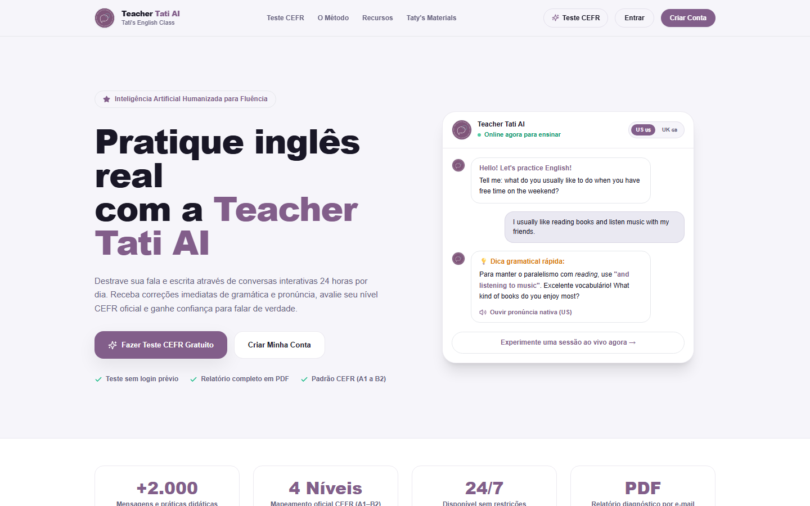
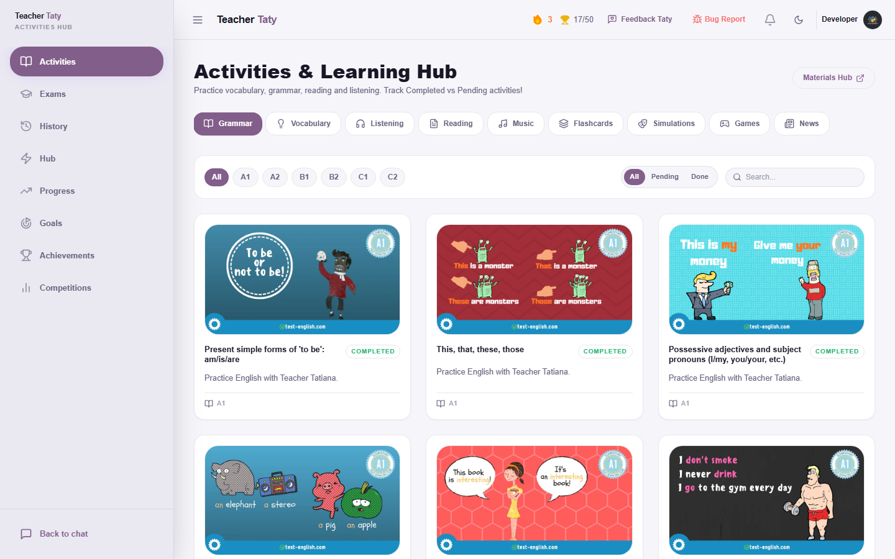
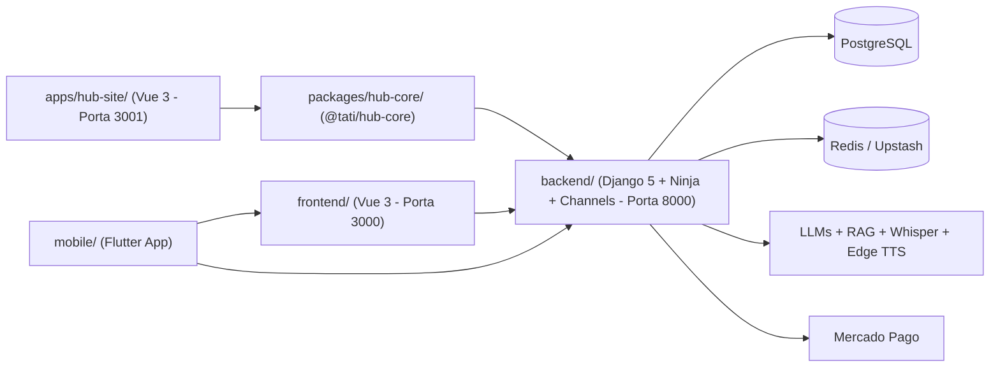

# Teacher Tatiana AI (Tati AI)

Plataforma educacional interativa para ensino e pratica da lingua inglesa alinhada ao quadro internacional **CEFR (A1 a C2)**. O ecossistema integra tutoria conversacional por texto e voz com Inteligencia Artificial, laboratorio de pronuncia, repeticao espacada (SRS), atividades multimodais, portal comercial de materiais didaticos digitais com leitura protegida (**Taty's Materials**) e painel administrativo docente.

- **Aplicacao Principal (Web)**: `https://tati-ai.vercel.app`
- **Portal Hub de Materiais**: `https://tati-hub.vercel.app`



---

## 1. Funcionalidades Principais

- **Tutoria Conversacional por Texto e Voz (`/chat`, `/voice`, `/voice-only`)**: pratica disponivel 24/7 com correcoes gramaticais imediatas, sugestoes de vocabulario, exportacao da conversa em PDF/DOCX, suporte a multiplos sotaques (`en-US`, `en-GB`, `en-AU`, `en-CA`, `en-IE`, `en-IN`) e cenarios de roleplay baseados no nivel CEFR.
- **Laboratorio Fonetico (`/pronunciation`)**: avaliacao automatica de acuracia e fluencia palavra por palavra com historico de gravacoes e feedback orientado.
- **Central de Atividades e Gamificacao (`/activities`, `/flashcards/:deckId`, `/goals`, `/competitions`)**: flashcards visuais com repeticao espacada e revisao de sexta-feira, podcasts com transcricao, gramatica, leitura, listening, musica (LingoClip), jogos interativos (Wordwall), noticias graduadas, ofensiva diaria (streak), Objetivo da Semana e ranking de XP.
- **Teste de Nivelamento e Exames Trimestrais (`/cefr-test`, `/exams`)**: diagnostico gratuito de nivel CEFR para visitantes (com emissao de relatorio) e sistema de avaliacoes trimestrais adaptativas (atualmente em validacao controlada para perfis autorizados).
- **Hub de Materiais Protegido (`apps/hub-site/` e `/activities/hub`)**: vitrine publica de e-books e apostilas com compra avulsa via **Mercado Pago** (PIX com QR Code instantaneo e Cartao) e leitor seguro pagina a pagina em WebP com marca d'agua dinamica do usuario.
- **Painel Administrativo Docente (`/dashboard`)**: gestao de alunos, curadoria e geracao automatica de materiais CEFR apoiada por **RAG**, revisao de feedbacks estudantis, upload de conteudos premium, exportacao de relatorios e envio de comunicados via WhatsApp (**WAHA**).
- **Aplicativo Mobile (`mobile/`)**: aplicativo **Flutter** com `InAppWebView`, Google Sign-In nativo, notificacoes push via Firebase Cloud Messaging (FCM) e verificacao automatica de atualizacoes.



---

## 2. Stack Tecnologica Confirmada

| Camada | Tecnologias |
| :--- | :--- |
| **Backend** | Python 3.11/3.12, Django 5, Django Ninja (REST + OpenAPI), Django Channels 4 (WebSockets ASGI com Daphne/Uvicorn), Pydantic v2, Celery 5 + Celery Beat |
| **Frontend Principal (`frontend/`)** | Vue 3.5 (Composition API), Vite 6, TypeScript, Vue Router 4, Pinia, TanStack Vue Query 5, Tailwind CSS 3.4, Lucide Vue Next |
| **Portal Hub (`apps/hub-site/`)** | Vue 3.5, Vite 6, TypeScript, Vue Router 4, Pinia, TanStack Vue Query 5, Tailwind CSS 3.4, `@tati/hub-core` (`packages/hub-core/`) |
| **Mobile (`mobile/`)** | Flutter (Dart 3.2+), `flutter_inappwebview`, `firebase_messaging`, `google_sign_in` |
| **Banco, Cache e Midia** | PostgreSQL (Supabase / Railway), Redis / Upstash (`django-redis` + `AICache`), IndexedDB (cliente), Cloudinary, LibreOffice + Poppler + PyMuPDF |
| **IA e Audio** | Meta Llama 3.1 (HF Router), Groq (`gpt-oss-120b`/`20b` + Whisper Large V3 STT), Google Gemini, RAG com embeddings `BAAI/bge-large-en-v1.5`, Edge TTS + gTTS |
| **Pagamentos e Mensageria** | Mercado Pago (PIX, Checkout Pro, Webhooks), WAHA (WhatsApp), Brevo / Resend / SMTP, WebPush (VAPID) |

---

## 3. Visao de Arquitetura e Estrutura do Repositorio



Resumo dos diretorios principais na raiz do monorepo (consulte [`PROJECT_STRUCTURE.md`](./PROJECT_STRUCTURE.md) para a arvore detalhada):

```text
Tati_AI/
├── apps/hub-site/       # Portal SPA dedicado ao catalogo e leitura do Hub (@tati/hub-site)
├── packages/hub-core/   # SDK TypeScript compartilhado de sessao, autenticacao e catalogo
├── backend/             # API Django Ninja, WebSockets Channels, Celery, RAG e prompts de IA
├── frontend/            # Aplicacao SPA principal (alunos e painel administrativo da professora)
├── mobile/              # Aplicativo Android/iOS em Flutter
├── mobile_app/          # Documentacao historica/planejada (notas legadas Capacitor/Tauri)
├── pwa/                 # Utilitarios de icones e manifesto PWA
└── docs/                # Documentacao tecnica completa e auditorias de engenharia
```

---

## 4. Pre-requisitos e Configuracao Local

### Pre-requisitos
- **Python** `3.11` ou `3.12`
- **Node.js** `20+` e **npm**
- **PostgreSQL 15+** (ou URL de banco Supabase/Railway; há fallback SQLite apenas para inspecao basica)
- **Redis** *(opcional em desenvolvimento; faz fallback para memoria local)*

### Instalacao

1. Instale as dependencias JavaScript de todos os workspaces:
   ```bash
   npm install
   ```
2. Crie o ambiente virtual Python e instale os pacotes do backend:
   ```powershell
   # Windows (PowerShell)
   python -m venv .venv
   .\.venv\Scripts\Activate.ps1
   pip install -r backend\requirements.txt
   ```
   ```bash
   # Linux / macOS
   python3 -m venv .venv
   source .venv/bin/activate
   pip install -r backend/requirements.txt
   ```

---

## 5. Variaveis de Ambiente

Copie os arquivos de exemplo e preencha as chaves necessarias (nunca versione arquivos `.env`):

- Raiz / Backend: copie [`.env.example`](./.env.example) para `.env` (`DATABASE_URL`, `SECRET_KEY`, `JWT_SECRET_KEY`, `GROQ_API_KEY`, `HF_TOKEN`, `MERCADOPAGO_ACCESS_TOKEN`, `REDIS_URL`, `CLOUDINARY_*`, etc.).
- Frontend Principal: copie [`frontend/.env.example`](./frontend/.env.example) para `frontend/.env` (`VITE_API_URL`, `VITE_WS_URL`, `VITE_HUB_SITE_URL`).
- Portal Hub: copie [`apps/hub-site/.env.example`](./apps/hub-site/.env.example) para `apps/hub-site/.env` (`VITE_API_URL`, `VITE_MAIN_SITE_URL`).

Consulte a tabela completa de variaveis em [`docs/setup.md`](./docs/setup.md).

---

## 6. Banco de Dados, Migrations e Execucao

### Verificacao e Migrations
```bash
python backend/manage.py check
python backend/manage.py migrate
```
> A maioria dos modelos de dominio utiliza `managed = False` para preservar o esquema PostgreSQL existente em producao (sendo `PronunciationHistory` e tabelas internas do Django/Celery gerenciadas via `migrate`). Nos testes automatizados, o runner `app.settings.test` instancia todas as tabelas automaticamente em SQLite `:memory:`.

### Executando os Servicos
Em terminais separados na raiz do projeto:

```bash
# 1. Backend Django + Channels ASGI (http://localhost:8000)
python backend/manage.py runserver 0.0.0.0:8000

# 2. Frontend Principal (http://localhost:3000)
npm run dev:frontend

# 3. Portal Hub de Materiais (http://localhost:3001/materiais)
npm run dev:hub
```

Alternativamente, para subir backend, frontend e workers Celery via containers:
```bash
docker compose up --build
```

---

## 7. Documentacao da API e Testes

### Documentacao Interativa da API (OpenAPI / Swagger)
Com o backend em execucao, acesse:
- Swagger UI: `http://localhost:8000/docs` (ou `http://localhost:8000/api/v1/docs`)
- Healthcheck: `http://localhost:8000/health`

### Suite de Testes e Verificacao de Tipos
```bash
# Testes automatizados do Backend (SQLite em memoria)
DJANGO_SETTINGS_MODULE=app.settings.test python backend/manage.py test app apps.authentication apps.activities --noinput

# Verificacao TypeScript em todos os workspaces Vue/TS
npm run typecheck

# Build de producao dos frontends
npm run build --workspace frontend
npm run build --workspace @tati/hub-site

# Testes End-to-End com Playwright
npx playwright test
```

---

## 8. Deploy

- **Frontends (`frontend/` e `apps/hub-site/`)**: deploy continuo na **Vercel** configurado por [`vercel.json`](./vercel.json), [`frontend/vercel.json`](./frontend/vercel.json) e [`apps/hub-site/vercel.json`](./apps/hub-site/vercel.json).
- **Backend (`backend/`)**: containerizado via [`backend/Dockerfile`](./backend/Dockerfile) com deploy automatizado para **Hugging Face Spaces** ([`.github/workflows/deploy-hf.yml`](./.github/workflows/deploy-hf.yml)) e suporte a **Railway** ([`railway.json`](./railway.json)).
- **Mobile (`mobile/`)**: compilado com Flutter (`flutter build apk --release`), conforme [`mobile/README.md`](./mobile/README.md).

---

## 9. Documentacao Tecnica Detalhada (`/docs`)

- [Indice Geral da Documentacao](./docs/readme.md)
- [Estrutura Completa do Projeto (`PROJECT_STRUCTURE.md`)](./PROJECT_STRUCTURE.md)
- [Arquitetura do Sistema](./docs/architecture.md)
- [Guia do Backend (Django 5 + Django Ninja)](./docs/backend.md)
- [Guia do Frontend (Vue 3 + Vite + Hub)](./docs/frontend.md)
- [Mapeamento de Rotas e Layouts](./docs/frontend_route_mapping.md)
- [Configuracao e Execucao Local](./docs/setup.md)
- [Diretrizes e Padroes de Codigo](./docs/guidelines.md)
- [Analise de Bundle Vite](./docs/bundle_analysis.md)
- [Auditoria de Navegacao Vue Router](./docs/navigation_audit.md)
- [Auditoria de Estado Global e Ciclo de Vida](./docs/provider_audit.md)
